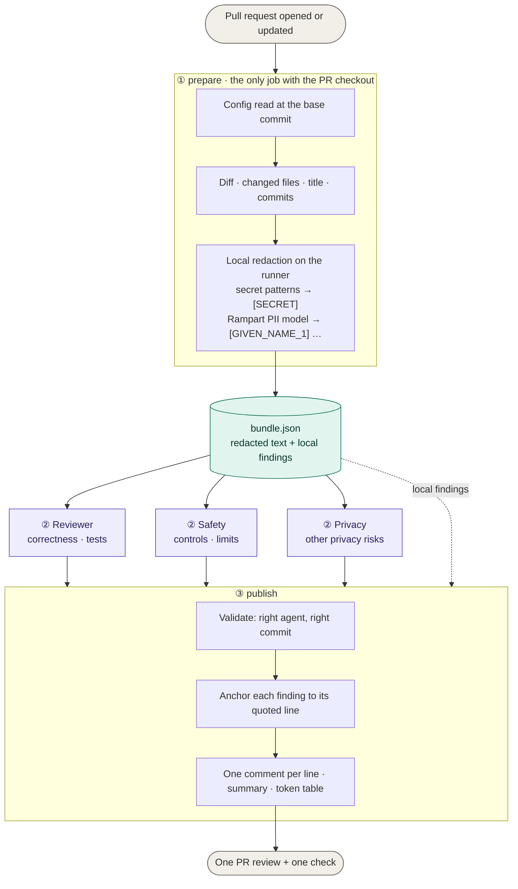
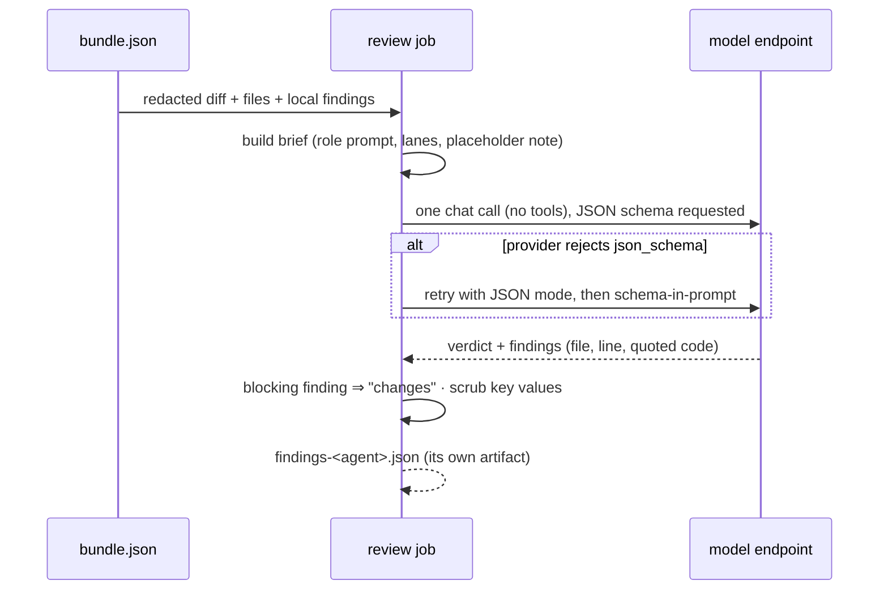

# Architecture

agent-review turns a pull request into **one** review written by up to three agents. Every text a model sees
has passed through a local redactor first, and no job holds more secrets than it needs.

- [The pipeline](#the-pipeline)
- [Step 1 · prepare](#step-1--prepare)
- [Step 2 · review](#step-2--review)
- [Step 3 · publish](#step-3--publish)
- [Trust model](#trust-model)
- [Code map](#code-map)
- [Measuring it](#measuring-it)

---

## The pipeline



| job | can read | can't read | GitHub permission |
|---|---|---|---|
| ① prepare | the PR checkout | the model API key | `contents: read` |
| ② review × N | `bundle.json` (redacted); the endpoint, model and key secrets | the code, any token | `contents: read`, no token passed |
| ③ publish | `bundle.json`, the agents' findings | the model API key, the code | `pull-requests: write` |

---

## Step 1 · prepare

`agent_review/prepare.py` is the only step that sees the PR's real content.

1. **Config at the base commit.** It reads `git show <base>:.github/agent-review.yml`, so a PR that edits
   the config changes nothing until it is merged. A missing file means defaults; unknown keys are an error.
2. **Who runs.** An agent runs if it is enabled, if its `paths` globs match a changed file (`[]` means every
   PR), and if a model is configured. That takes the secrets `AGENT_REVIEW_API_KEY`, `AGENT_REVIEW_BASE_URL`
   and `AGENT_REVIEW_MODEL`. The endpoint and model are secrets rather than config, so which provider a repo
   uses never appears in the public repository; `base_url` and `model` in the config are only a fallback. Drafts are skipped. There is no line limit by default (`skip.max_changed_lines: 0`); a PR over `warn_changed_lines` (1000) gets a warning in the review. The privacy
   agent's local half needs no key, so it always runs.
3. **One local pass** (`agent_review/pii.py`) over every line of the diff, the changed files, the title, the
   description and the commit messages:

   ```mermaid
   flowchart LR
       L[line] --> S{"provider key<br/>format?"}
       S -- yes --> SX["→ [SECRET]<br/>+ blocking finding"]
       S -- no --> X
       SX --> X["every line, whole<br/>(no string/comment parsing<br/>to get wrong)"]
       X --> F["skip obvious fakes<br/>example.com · Jane Doe · 555-01xx"]
       F --> M["Rampart<br/>(on-device, CC BY 4.0)"]
       M --> O["placeholders<br/>[GIVEN_NAME_1] [EMAIL_1] [SSN_1]"]
       M --> FN["local findings: never blocking<br/>highlighted in place on the line<br/>names only if name-shaped;<br/>in code only in strings/comments or data-like"]
   ```

   - **Secret patterns** cover the formats Rampart does not detect: Anthropic, OpenAI, Stripe, GitHub,
     GitLab, AWS, Google and Slack keys, PEM private keys, and credentials in URLs.
   - **Rampart** runs once per PR on the runner. One batch means the same value gets the same placeholder
     everywhere. The node process gets no credentials.
   - **Line structure is preserved,** so line numbers in the redacted text match the real files.
   - **Hunk headers are cut** to their line ranges. Git appends a nearby source line to each `@@` header,
     and that text would otherwise bypass redaction.
   - **File paths are not redacted.** They appear in the PR on GitHub anyway; don't put personal data in
     file names.
   - **It fails closed:** if the model can't run, prepare fails and nothing is sent anywhere.
4. **Size guard.** If the redacted diff is over `max_context_chars`, the model agents don't run: a partial
   review could miss the real change. That counts as a gap.
5. **Gaps.** With `blocking: true`, an enabled agent that cannot run fails the job (for example a fork PR,
   which gets no secrets, or an over-size diff). Otherwise it is a notice.

`bundle.json` holds the redacted diff, files, title, description and commits; the local findings; the agent
list; and the non-secret config. It never contains the key, the endpoint or the model from the secrets. It is
kept for one day.

---

## Step 2 · review

`agent_review/review.py`, one job per agent, in parallel. **No checkout, no GitHub token.**



- **One engine, two wire formats.** The endpoint and model come from secrets. `api: openai` is any
  OpenAI-compatible chat-completions endpoint:
  OpenAI, Gemini, OpenRouter, Mistral, Groq, Together, Ollama, vLLM and others. `api: anthropic` is
  Anthropic's Messages API. Redirects are refused, so the key is never resent elsewhere. `base_url` must be
  https, or http on localhost.
- **Lanes keep agents from repeating each other.** Each brief names what the other running agents own. The
  reviewer also takes over the lane of any agent that is switched off.

  | lane | owner |
  |---|---|
  | correctness, behaviour, compatibility, tests | reviewer |
  | other privacy risks: secrets in unusual formats, runtime exposure of data, names in file paths, home paths, internal hosts | privacy |
  | auth, permissions, approvals, limits, validation at trust boundaries, fail-open, bugs that weaken a control | safety |

- **The privacy agent does not look for personal data.** Rampart reports that locally; the model covers
  other privacy risks and is told which lines Rampart already flagged.
- **The output schema** is `verdict`, `summary`, and `findings[]` with `file`, `line`, `code` (the exact
  line), `severity` (`blocking` or `suggestion`), `category` and `message`. Anything else, such as no JSON,
  the wrong shape or an HTTP error, becomes `status: error`, which is never an approval.

---

## Step 3 · publish

`agent_review/publish.py`. Plain code, working from the bundle alone.

1. **Integrity:** each agent's file must name that agent and the head commit. A missing, stale or forged
   file becomes "did not complete, not approved".
2. **Privacy = Rampart's findings + the model's other concerns, in one section.** The section opens with "N
   line(s) with potential PII", a reminder that these are never blocking and may be wrong, and one comment
   per line with the detected text underlined in place. Provider-format secrets stay masked as `[SECRET]` and
   are blocking. With no key, the local findings stand alone.
3. **Anchoring:** models misnumber lines, but their quoted `code` is reliable. Each finding moves to the
   line holding that text (in the redacted file, so placeholders match).
4. **One comment per line,** crediting every agent that flagged it. Findings that GitHub can't anchor,
   because their line isn't in the diff, go in the summary.
5. **Summary table:** the result, blocking and suggestion counts, and tokens (fresh / cached / out) per
   agent, plus a total. **Tokens, not dollars, are the cost measure:** they compare across providers.
6. **Final scrub** of credential formats over everything posted. The review is posted as `event: COMMENT`;
   earlier agent reviews on other commits are collapsed to "superseded".
7. **Exit 1** only when `blocking: true` and something requested changes or did not complete.

---

## Trust model

| actor | can influence | cannot |
|---|---|---|
| PR author (same repo) | the diff and PR text the agents read | the config (read at base), other agents' results, the key |
| PR author (fork) | the same, but gets no secrets: only the local privacy scan runs | anything needing a secret |
| a manipulated model | its own findings and verdict | other agents' artifacts, the code, any token, the merge |
| the model provider | sees redacted text only | raw personal data or provider-format keys |
| maintainers | the config and the secrets | — |

Two caveats:

- On `pull_request`, the calling workflow file comes from the PR, so a PR can edit
  `.github/workflows/agent-review.yml` itself. Protect `.github/workflows/` with CODEOWNERS and required
  reviews.
- This repository reviews its own PRs with the PR's own code (`self-review.yml`), so a PR here can change the
  redactor that guards its own review. That's acceptable only because same-repo PRs come from people with
  write access; fork PRs get no secrets. Other repositories pin a released tag instead.

---

## Code map

```
agent_review/
├── config.py        config schema, read at the base commit
├── diff.py          one diff parser (hunk counting, quoted paths, -z path lists)
├── pii.py           secret patterns + Rampart: redaction and local findings
├── js/pii.mjs       Rampart wrapper (node, offline once cached)
├── prepare.py       ① checkout → bundle.json
├── llm.py           ② one chat call: openai-compatible or anthropic
├── review.py        ② prompts, lanes, schema, fail-closed normalisation
├── publish.py       ③ validate, anchor, group, post
└── prompts/         reviewer.md · privacy.md · safety.md
.github/workflows/
├── review.yml       the reusable workflow (prepare → review × N → publish)
├── self-review.yml  this repo reviews its own PRs with the PR's version
└── ci.yml           lint + tests
bench/               planted-problem PRs and a scorer
```

## Measuring it

`bench/cases.py` holds fictional PRs, each with planted problems identified by their exact line, plus clean
PRs and strings that must never reach a model. `bench/run.py` builds each case as a git repo, runs the real
pipeline (prepare with the real Rampart, then review, then publish `--dry-run`), and reports:

- **caught**: an agent commented on the planted line;
- **blocked**: that comment was blocking;
- **false blocks**: blocking comments on clean PRs;
- **unredacted sends**: a must-never-send string found in the bundle;
- **tokens** per case.
